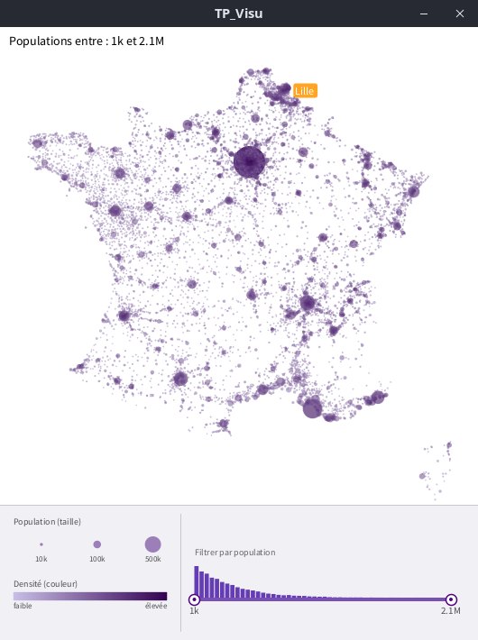

# TP5 — Visualisation d'information

## Description

Visualisation interactive des villes de France réalisée en **Processing**. Chaque ville est représentée par un cercle dont la **taille** encode la population et la **couleur** encode la densité. L'utilisateur peut explorer la carte via zoom, panoramique et filtrage par population.

## Prérequis

- [Processing 4](https://processing.org/download)
- Le fichier `data/villes.tsv` (inclus dans le dépôt)

## Lancement

Ouvrir `TP_Visu.pde` dans Processing et appuyer sur le bouton **Run** (ou `Ctrl+R`).

## ⚠️ Important : Redimensionnement de la fenêtre (Sizing)

**À noter :** Les dimensions par défaut de l'application (`size(530, 680)`) ont été volontairement restreintes. Ce choix technique a été fait pour garantir que l'intégralité de l'interface (carte + panneau) tienne sur l'écran de mon ordinateur portable lors de la soutenance orale, sans nécessiter de défilement. L'application a également été testée sur les machines M5 de l'université et s'y affiche parfaitement.
> 
> Cependant, si vous possédez un écran plus grand, **il est possible d'agrandir la fenêtre** pour bénéficier d'une carte beaucoup plus détaillée et d'un meilleur confort visuel.

### Comprendre la logique de redimensionnement

Pour modifier la taille de la fenêtre, il ne suffit pas de changer uniquement la fonction `size()`. L'interface obéit à une règle stricte: 
- La zone de la carte géographique est **toujours un carré**. La largeur de la fenêtre (`width`) doit donc toujours être égale à la variable `MAP_HEIGHT`.
- Le panneau de contrôle en bas possède une hauteur fixe (`PANEL_HEIGHT = 150`).
- La hauteur totale de l'application est donc toujours égale à : `MAP_HEIGHT + PANEL_HEIGHT`.

**Valeurs actuelles par défaut :**
- `MAP_HEIGHT = 530` 
- [cite_start]`PANEL_HEIGHT = 150` 
- [cite_start]Résultat dans le setup : `size(530, 680)` (car 530 + 150 = 680).

### Comment adapter l'application à un grand écran ?

[Si vous souhaitez agrandir l'affichage, suivez ces étapes avec précision dans le fichier `TP_Visu.pde:

1. **Choisissez la nouvelle largeur de votre carte** (par exemple, 800 pixels).
2. **Modifiez la variable correspondante** en haut du code : `int MAP_HEIGHT = 800;`
3. **Calculez la nouvelle hauteur totale** en ajoutant les 150 pixels du panneau (800 + 150 = 950).
4. **Mettez à jour la fonction `size()`** dans le `setup()` avec vos nouvelles valeurs : `size(800, 950);`

*Exemple de code modifié pour un grand écran :*
```java
int MAP_HEIGHT = 800;
int PANEL_HEIGHT = 150; 

void setup() {
  size(800, 950);
  // ... reste du code ...
}
```

### Aperçu sur les machines M5 de l'université

Voici quelques captures d'écran de l'application en cours d'exécution sur les postes de l'université :




## Interactions

| Action | Effet |
|--------|-------|
| Survol d'une ville | Affiche le nom de la ville avec un anneau orange |
| Clic sur une ville | Sélectionne/désélectionne la ville (label orange persistant) |
| Cliquer-glisser (carte) | Panoramique de la carte |
| Molette | Zoom centré sur la position du curseur |
| Slider population | Filtre les villes affichées par plage de population (échelle logarithmique) |
| Flèches ↑ / ↓ | Augmente / diminue le seuil minimum de population |

## Structure des fichiers

| Fichier | Rôle |
|---------|------|
| `TP_Visu.pde` | Sketch principal — chargement des données, rendu, interactions |
| `City.pde` | Classe `City` — représentation et affichage d'une ville |
| `data/villes.tsv` | Données des villes françaises (code postal, coordonnées, population, surface, altitude) |

## Encodages visuels

| Variable | Encodage | Détail |
|----------|----------|--------|
| Population | Taille du cercle (rayon) | Proportionnel à √population, entre 0.5 et 18 px |
| Densité | Couleur | Dégradé lilas clair → violet foncé (échelle log) |

## Choix de conception notables

### Échelle logarithmique pour le slider

La plage de population s'étend de ~1 000 à ~2 000 000 habitants. Une échelle linéaire rendrait les petites villes impossibles à filtrer finement. L'échelle logarithmique donne un contrôle proportionnel sur toute la plage.

### Tri des villes par population décroissante

Les villes sont triées au chargement (`Arrays.sort`) afin que les grandes villes soient dessinées en premier et les petites par-dessus — évitant qu'elles soient masquées.

### Zoom ancré sous le curseur

Le zoom recalcule `panX` et `panY` pour que le point sous le curseur reste fixe visuellement, ce qui donne un comportement naturel de type carte.

### Histogramme au-dessus du slider

Un histogramme de distribution des populations est affiché au-dessus du slider, avec les barres dans la plage sélectionnée colorées différemment — donnant un retour visuel immédiat sur le nombre de villes filtrées.

