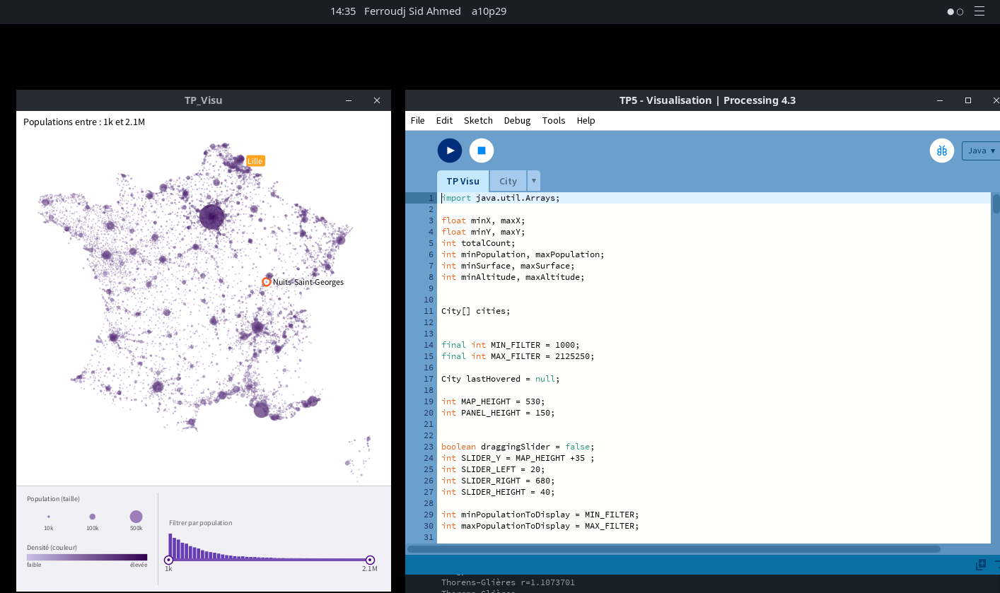

# France Cities DataViz — Interactive Geospatial Visualization in Processing

**France Cities DataViz** is an interactive information visualization application built with **Processing 4** that maps French municipalities using demographic and geographic datasets (`villes.tsv`). Each city is rendered using multi-variable visual encodings—circle radius mapped to population and color mapped to population density—paired with cursor-anchored zooming, panning, and a logarithmic population range filter.

---

## Preview

| Overview & Density Encoding | Zoomed Exploration & Selection |
| :---: | :---: |
|  |  |

---

## Visual Encodings & Design Choices

| Data Variable | Visual Channel | Implementation Details |
| :--- | :--- | :--- |
| **Population** | Circle Radius | Scaled proportionally to $\sqrt{\text{population}}$ (clamped between $0.5\text{ px}$ and $18\text{ px}$) |
| **Population Density** | Color Gradient | Logarithmic color scale transitioning from light lilac to deep violet |
| **Geographic Coordinates** | 2D Spatial Position | Projected onto a square map viewport (`MAP_HEIGHT x MAP_HEIGHT`) |

### Key Interaction & Rendering Engineering
* **Logarithmic Population Slider & Live Histogram:** Because French city populations span roughly $1{,}000$ to over $2{,}000{,}000$ inhabitants, a linear slider would compress smaller towns into an unusable sliver. A logarithmic range slider—paired with an integrated population distribution histogram that dynamically highlights active bins—provides fine-grained filtering across the entire spectrum.
* **Occlusion-Free Painter's Order (`Arrays.sort`):** Cities are sorted in descending order of population at startup so larger metropolitan circles are drawn first and smaller towns are rendered on top, preventing small municipalities from being hidden underneath major cities.
* **Cursor-Anchored Zooming:** Mouse-wheel zooming dynamically recalculates `panX` and `panY` so the geographic coordinate directly beneath the cursor remains stationary, delivering natural map-style navigation.

---

## Interactive Controls

| Input | Action |
| :--- | :--- |
| **Hover over a city** | Highlights the city with an orange ring and displays its name |
| **Click a city** | Toggles persistent selection with a pinned orange label |
| **Click + Drag (Map)** | Pans across the map viewport |
| **Mouse Wheel** | Zooms in/out anchored on the current cursor position |
| **Population Range Slider** | Filters visible municipalities using a logarithmic population scale |
| **Up / Down Arrows (`↑` / `↓`)** | Increments or decrements the minimum population threshold |

---

## Project Structure

| File | Responsibility |
| :--- | :--- |
| `TP_Visu.pde` | Main Processing sketch: TSV dataset ingestion, sorting, spatial projection, UI rendering, and event handling |
| `City.pde` | `City` data model encapsulating coordinates, population, surface area, density calculation, and rendering |
| `data/villes.tsv` | French municipalities dataset (postal code, coordinates, population, surface area, altitude) |
| `img/` | Application screenshots (`screenshot1.png`, `screenshot2.png`) |

---

## Getting Started & Viewport Sizing

### Prerequisites
* **[Processing 4](https://processing.org/download)**

### Running the Sketch
1. Open `TP_Visu.pde` in the **Processing IDE**.
2. Click **Run** (or press `Ctrl+R`).

### Adapting Window Dimensions to Larger Displays
The default canvas size (`size(530, 680)`) is intentionally compact to fit smaller laptop screens without scrolling. Because the geographic viewport must remain strictly square (`MAP_HEIGHT x MAP_HEIGHT`) above a fixed control panel (`PANEL_HEIGHT = 150`), total window height must always equal `MAP_HEIGHT + PANEL_HEIGHT`.

To expand the display for high-resolution monitors, update both `MAP_HEIGHT` and `size()` in `TP_Visu.pde`:

```java
int MAP_HEIGHT = 800;
int PANEL_HEIGHT = 150;

void setup() {
  size(800, 950); // Width = MAP_HEIGHT, Height = MAP_HEIGHT + PANEL_HEIGHT
  // ...
}
```